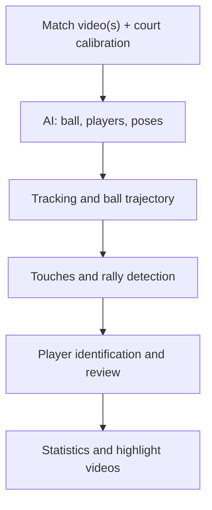

# Volleyball Studio

**Turn volleyball match recordings into searchable rallies, player analysis and highlight videos with AI.**

**English** · [Русский](README.ru.md) · [Documentation](docs/README.md)

## What it does

| Feature | Result |
| --- | --- |
| Ball and player tracking | Ball trajectory, player positions and body keypoints |
| Touch recognition | Serves, receptions, sets, attacks and blocks |
| Rally detection | A list of rallies across one or more match videos |
| Player identification | Match tracked players to reference photos and confirm their identities |
| Match review | Navigate rallies, inspect overlays and filter events |
| Video editing | Assemble selected rallies, player highlights and custom clips |

## How it works

[Ball tracking example](examples/output.gif) · [Touch detection example](examples/player-touch.gif)

## Get started

Volleyball Studio runs locally with a browser interface. The application uses Rust, WebAssembly, ONNX Runtime, CUDA and FFmpeg. AI analysis requires compatible models and GPU dependencies.

- [Installation and launch](docs/RUST_DEPLOYMENT.md)
- [Full documentation](docs/README.md)

> The project is experimental. AI-generated events and player matches may require human verification.
