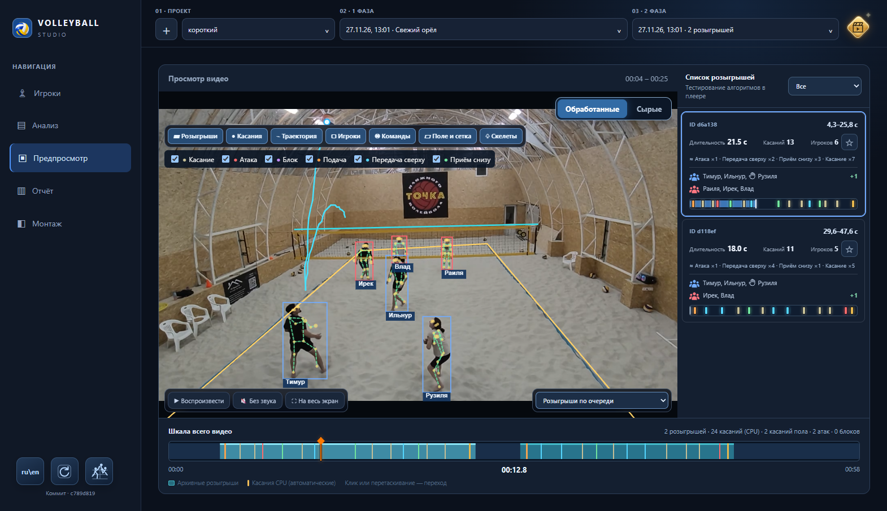
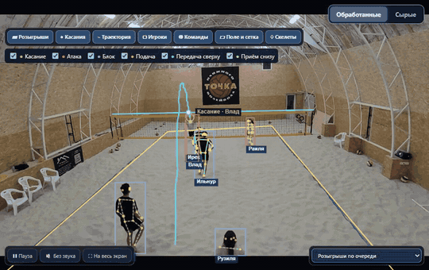
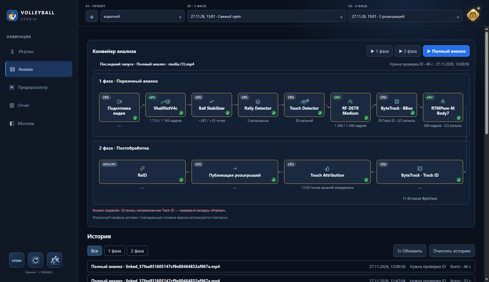

# Volleyball Studio

**AI-powered volleyball match analysis and highlight editing.**

Import a match video. Studio tracks the ball and players, detects touches and rallies, and lets you review the game or create highlight videos from the original recording.

[Русский](README.ru.md) · [Documentation](docs/README.md) · [Installation](docs/RUST_DEPLOYMENT.md)

[Full-quality MP4](docs/images/studio-demo.mp4?raw=true)

## From match video to highlights

- **Analyze:** ball trajectory, player tracking, body poses, court and net, touches and rally boundaries.
- **Review:** navigate rallies, verify touch types and player identities, inspect statistics.
- **Edit:** select rallies and individual player moments, assemble clips and export video.

## Analysis pipeline

GPU detection uses VBallNet V4c, RF-DETR Medium and RTMPose-M Body7. Ball stabilization, rally and touch detection, tracking and touch attribution turn observations into reviewable game events. ReID suggests player identities for confirmation.

The application runs locally on Rust with a browser interface. The screenshots and video show an actual analysis in the current Studio, not a mockup. AI results may require human review.

**[Full documentation →](docs/README.md)**
