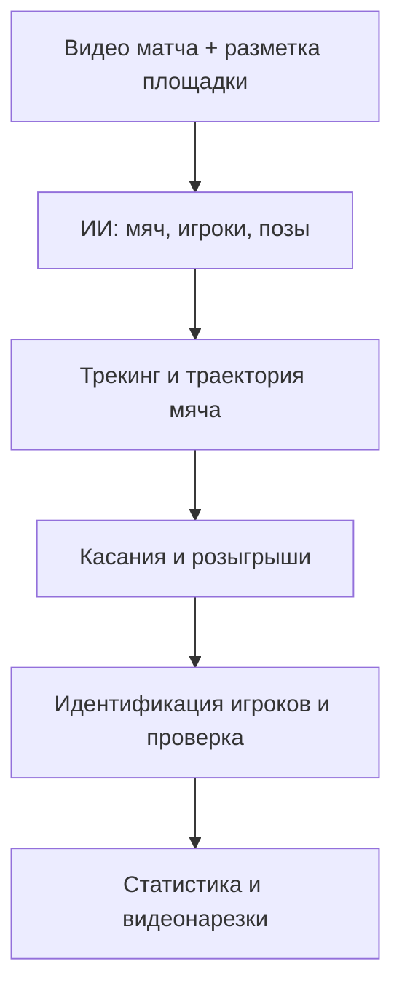

# Volleyball Studio

**Студия на базе ИИ, которая превращает записи волейбольных матчей в размеченные розыгрыши, статистику игроков и видеонарезки.**

[English](README.md) · **Русский** · [Документация](docs/README.md)

## Возможности

| Функция | Результат |
| --- | --- |
| Отслеживание мяча и игроков | Траектория мяча, положение игроков и скелеты |
| Распознавание касаний | Подачи, приёмы, передачи, атаки и блоки |
| Определение розыгрышей | Список розыгрышей из одного или нескольких видео |
| Идентификация игроков | Сопоставление треков с фотографиями и подтверждение личности |
| Просмотр матча | Навигация по розыгрышам, визуальная разметка и фильтры событий |
| Видеомонтаж | Нарезки розыгрышей, моментов отдельных игроков и выбранных фрагментов |

## Как это работает

[Пример трекинга мяча](examples/output.gif) · [Пример определения касаний](examples/player-touch.gif)

## Начало работы

Студия работает локально с интерфейсом в браузере. В основе — Rust, WebAssembly, ONNX Runtime, CUDA и FFmpeg. Для ИИ-анализа нужны совместимые модели и GPU-зависимости.

- [Установка и запуск](docs/RUST_DEPLOYMENT.md)
- [Подробная документация](docs/README.md)

> Проект экспериментальный. Результаты распознавания событий и игроков могут требовать проверки человеком.
