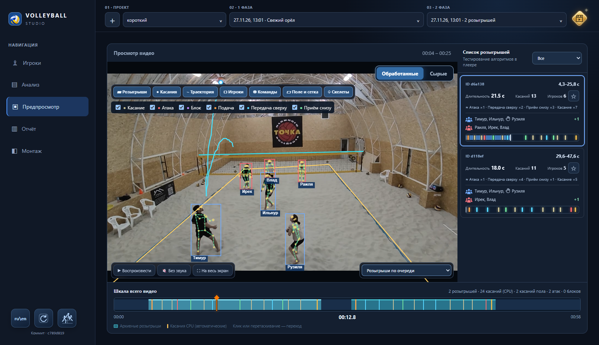
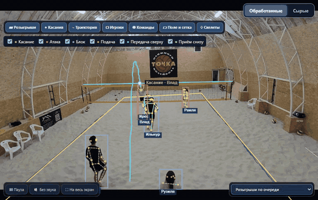
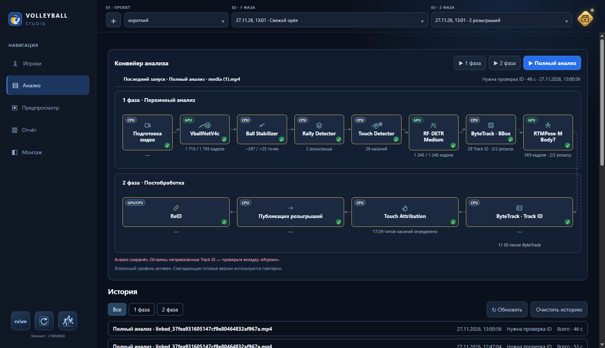

# Volleyball Studio

**ИИ-студия анализа волейбольных матчей и видеомонтажа.**

Загрузите видео матча. Студия отслеживает мяч и игроков, определяет касания и розыгрыши, помогает разобрать игру и смонтировать лучшие моменты из оригинальной записи.

[English](README.md) · [Документация](docs/README.md) · [Установка и запуск](docs/RUST_DEPLOYMENT.md)

[MP4 в исходном качестве](docs/images/studio-demo.mp4?raw=true)

## От записи матча до видеонарезки

- **Анализ:** траектория мяча, трекинг игроков, скелеты, площадка и сетка, касания и границы розыгрышей.
- **Разбор игры:** навигация по розыгрышам, проверка типов касаний и личности игроков, статистика.
- **Монтаж:** отбор розыгрышей и моментов отдельных игроков, сборка фрагментов и экспорт видео.

## Конвейер анализа

GPU-детекция использует VBallNet V4c, RF-DETR Medium и RTMPose-M Body7. Стабилизация мяча, определение розыгрышей и касаний, трекинг и классификация касаний превращают наблюдения в события игры. ReID предлагает соответствия игроков для подтверждения.

Студия работает локально на Rust с интерфейсом в браузере. Скриншоты и видео — из реального анализа в работающей студии, а не макеты. Результаты ИИ могут требовать проверки человеком.

**[Подробная документация →](docs/README.md)**
