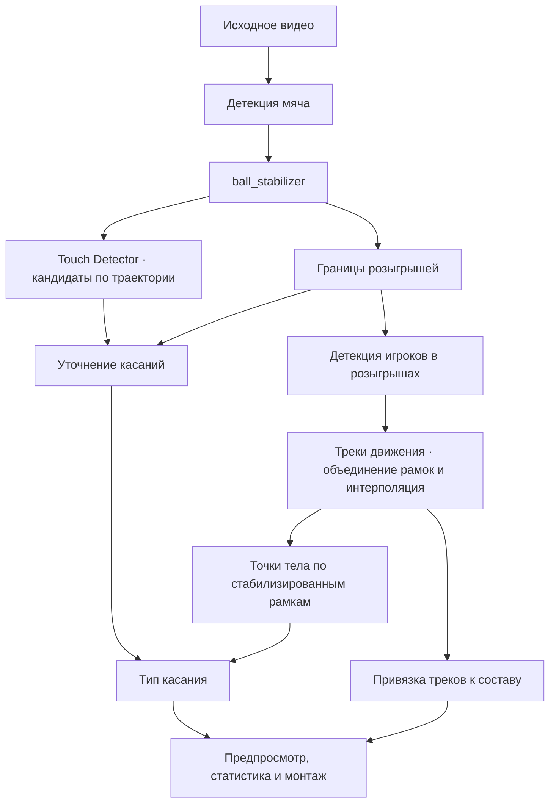

# Последовательность анализа розыгрыша

На вход следующей стадии поступает стабилизированный трек с одной итоговой рамкой игрока на кадр. Измеренные и интерполированные рамки имеют разное происхождение. Для классификации касания нужна пригодная поза рядом с моментом события. При недостатке данных тип остаётся неопределённым.

## Текущий этап реализации

Новый анализ один раз вычисляет и сохраняет траекторию после VBallNet. Первичная маска хранит параметры и контрольную сумму траектории. Касания и предпросмотр читают те же точки через артефакт, привязанный к CPU replay. Для ранее сохранённых анализов без нового артефакта поддерживается прежний CPU-пересчёт.

Порядок стадий от детекции мяча до маски розыгрышей реализован. Предварительная поза пока используется при ассоциации рамок.

Touch Detector ищет разрывы движения сразу после стабилизации. Уточнение использует сохранённые кандидаты, границы розыгрыша, калибровку площадки и свидетельства о положении игрока.
